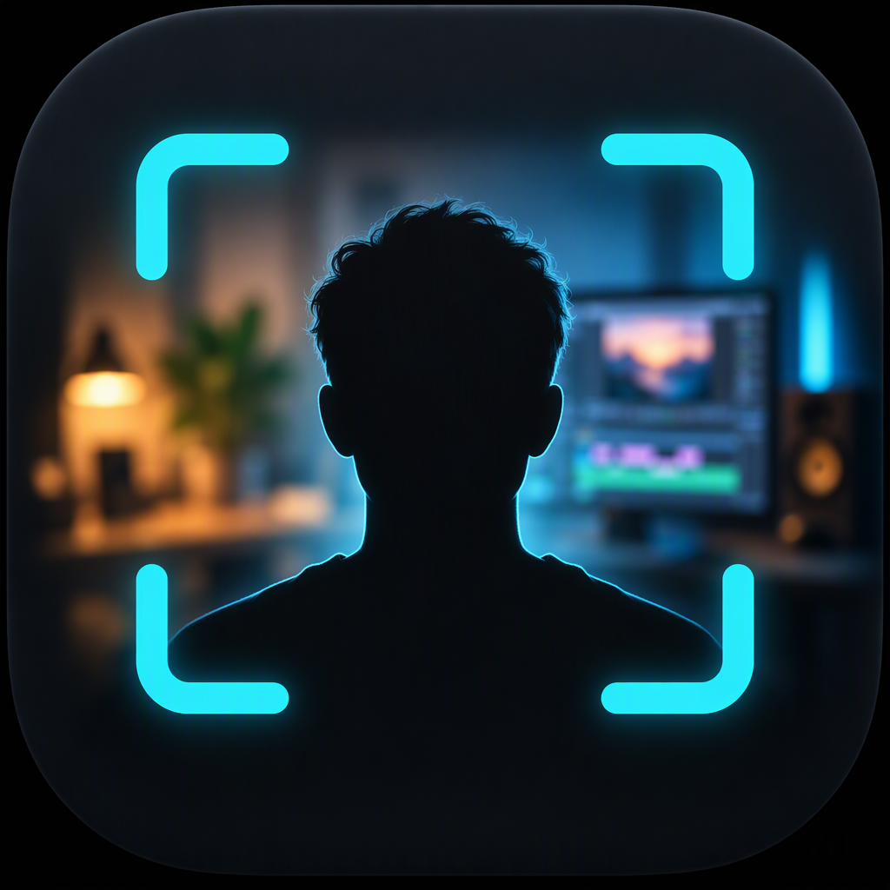
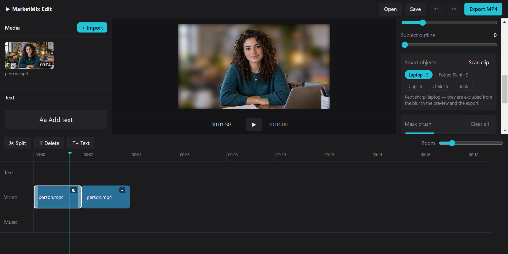

<p align="center">
  
</p>

<h1 align="center">MarketMix Edit</h1>

<p align="center">
  <b>Free, open-source desktop video editor with on-device AI background blur.</b><br />
  Focus on the subject, blur the background, keep a laptop or a cup sharp, fix the cutout with a brush —<br />
  all offline, with no account, no watermark and no telemetry.
</p>

<p align="center">
  <a href="https://github.com/marketmixfoundation-a11y/marketmix-edit/releases/latest"></a>
  
  
</p>

<p align="center">
  
</p>

MarketMix Edit is built on the CapRocket editor (MIT). The editor skeleton — timeline, media library,
inspector, text overlays, music track and FFmpeg export — is CapRocket's. MarketMix Edit adds the
AI focus effects described below.

## Features

- **Background blur** — MediaPipe selfie segmentation runs on your machine (WebAssembly + GPU). The
  subject stays sharp, the background gets a soft blur you control with a slider.
- **Smart objects** — scan a clip and the app lists what it recognises (laptop, cup, chair, book…).
  Click an object to keep it sharp inside the blur, e.g. a laptop in front of the subject.
- **Mask brush** — paint on the preview to erase or restore parts of the subject mask. Corrections
  are stored per clip and applied to every frame.
- **Subject outline** — optional coloured outline around the final mask, with size and colour.
- **Edge softness** — feather the cutout so it blends into the blur.
- **Edges** — a separate edge-detection look with its own strength.
- **Export** — everything is baked into the MP4 with FFmpeg: blur, outline, edges, text overlays,
  clip audio and the music track.

<p align="center">
  
</p>

## Download and install

1. Download the latest **MarketMix-Edit-Setup-*.exe** from
   [Releases](https://github.com/marketmixfoundation-a11y/marketmix-edit/releases/latest).
2. Run it and choose an install folder. Setup creates Start Menu and Desktop shortcuts.
3. Windows SmartScreen may warn because the build is not code-signed: **More info → Run anyway**.

Requirements: Windows 10 or 11, 64-bit. The app runs fully offline.

## Privacy

- The segmentation and object-detection models are bundled with the app.
- MediaPipe's optional telemetry endpoint is blocked by the app's Content Security Policy.
- Your videos never leave your computer. No account, analytics or ads.

## Build from source

```bash
npm install
npm start          # build the interface and launch
npm run dist       # build the Windows installer into release/
```

Requires Node.js 20+ and npm. The first build downloads Electron.

## Project layout

| Path | Content |
| --- | --- |
| `src/` | React interface (editor, preview compositor, inspector) |
| `src/effects.js` | Background-blur model, mask compositing, kept-object painting |
| `src/mediapipe.js` | Selfie segmenter loading (GPU with CPU fallback) |
| `src/objects.js` | EfficientDet-Lite0 object detector, clip scanning |
| `src/maskexport.js` | Per-frame mask generation for export |
| `electron/ffmpeg.cjs` | FFmpeg filter graph (blur, outline, edges) |
| `electron/main.cjs` | Electron shell, `app://` protocol, mask streaming |
| `public/mediapipe/` | Bundled models and WASM runtime |

## Credits and license

MIT — see [LICENSE](LICENSE).

- Editor base: [CapRocket](https://github.com/medhachim/CapRocket) by its contributors (MIT).
- Segmentation: [MediaPipe Selfie Segmenter](https://developers.google.com/mediapipe) (Apache 2.0).
- Object detection: [MediaPipe EfficientDet-Lite0](https://developers.google.com/mediapipe) (Apache 2.0).
- Video processing: [FFmpeg](https://ffmpeg.org) via `ffmpeg-static` (LGPL/GPL build).

MarketMix Edit is an independent project and is not affiliated with CapRocket.
